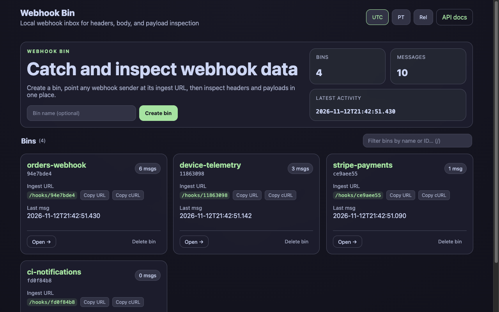
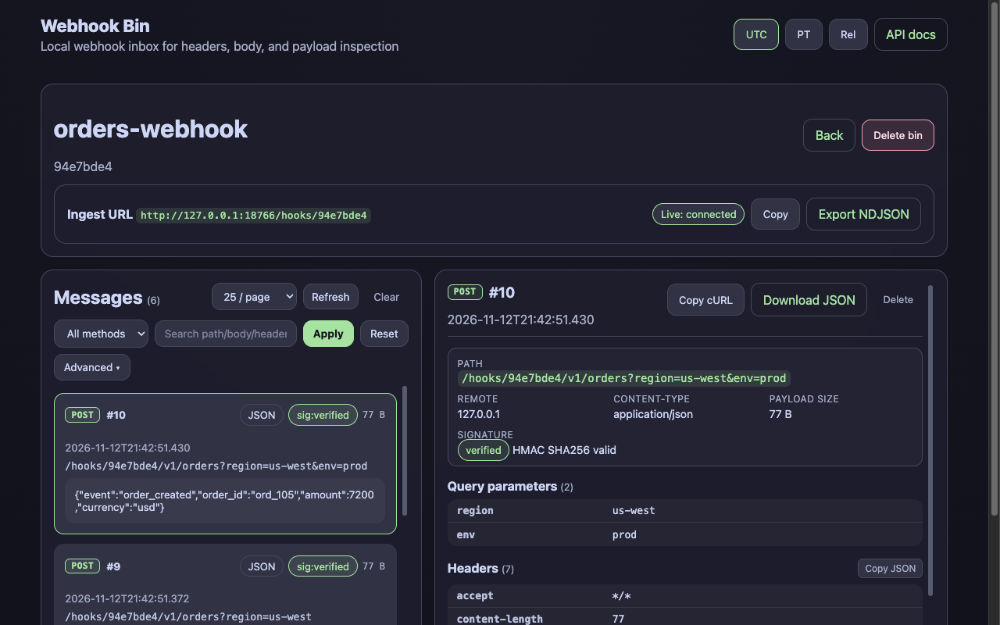

# Webhook Bin

A local-first webhook inbox for inspecting webhook payloads, headers, and
traffic — like a self-hosted `webhook.site` you can run on your laptop or a
Raspberry Pi.

Create a bin, point any webhook sender at its ingest URL, and inspect incoming
requests in a real-time dashboard.

## Screenshots

**Home** — bins overview with live totals, instant filter, and one-click URL / cURL copy:



**Bin dashboard** — live message feed on the left, structured query/headers and JSON/raw body on the right:



## Features

- **Flexible ingest** — unique `/hooks/<bin_id>` URL per bin (accepts `GET`, `HEAD`, `POST`, `PUT`, `PATCH`, `DELETE`, `OPTIONS`, plus arbitrary subpaths `/hooks/<bin_id>/...`), backed by SQLite WAL
- **Live dashboard** — instant SSR bootstrap + SSE stream (shared across tabs via Web Locks + `BroadcastChannel`) with backoff polling fallback
- **Rich inspection** — HTTP method badges, payload byte sizes, parsed query parameters & headers, `Pretty` / `Compact` / `Raw` body modes, and `#msg-<id>` deep links
- **Search & filter** — full-text query, HTTP method filter, header key/value matching, and cursor pagination
- **Replay & export** — one-click copy for body, headers JSON, or a runnable replay `curl` command; download single message JSON or bin-wide NDJSON
- **Cleanup without rotating URLs** — delete individual messages or clear all messages in a bin while keeping its ingest URL active
- **Verification & retention** — optional HMAC-SHA256 verification (`x-signature-sha256`, `x-hub-signature-256`, `x-mist-signature-v2`, `x-signature`) and per-bin retention by age or count
- **Operations ready** — `UTC` / `PT` / `Rel` timestamps, JSON API, `/healthz`, Prometheus `/metrics`, and SQLite `backup` / `restore` CLI

## Quickstart

Requires **Python 3.11+**.

```bash
python3 -m venv .venv
source .venv/bin/activate
pip install -e .
webhook-bin
```

Open:

- **Dashboard** — http://127.0.0.1:8000/
- **OpenAPI docs** — http://127.0.0.1:8000/docs

Create a bin in the UI (or via `POST /api/bins`), then send a test webhook:

```bash
curl -X POST 'http://127.0.0.1:8000/hooks/<bin_id>/v1/events?env=dev' \
  -H 'content-type: application/json' \
  -d '{"hello":"world"}'
```

## Keyboard shortcuts

| Key | Where | Action |
| --- | --- | --- |
| `/` | Home / Bin dashboard | Focus search / filter input |
| `Esc` | Search input | Clear / unfocus filter input |
| `↑` / `↓` | Bin dashboard | Select previous / next message |
| `r` | Bin dashboard | Refresh message list |

## Configuration summary

All settings are optional environment variables (full details in [docs/configuration.md](docs/configuration.md)):

| Variable | Default | Purpose |
| --- | --- | --- |
| `WEBHOOK_BIN_HOST` / `WEBHOOK_BIN_PORT` | `0.0.0.0` / `8000` | Server bind address and port |
| `PUBLIC_BASE_URL` | _(request origin)_ | Public base URL used for displayed ingest URLs and replay `curl` commands |
| `WEBHOOK_BIN_HMAC_SECRET` | _(unset)_ | Shared secret to verify incoming HMAC-SHA256 signature headers |
| `WEBHOOK_BIN_MAX_BODY_BYTES` | `1048576` (1 MB) | Maximum accepted webhook request body size |
| `WEBHOOK_BIN_RETENTION_DAYS` | `0` (disabled) | Per-bin automatic pruning by age (days) |
| `WEBHOOK_BIN_RETENTION_MAX_MESSAGES` | `10000` | Max retained messages per bin (`0` disables) |

## Data & backups

SQLite data is stored at `data/webhook_bin.db` (created automatically in the working directory).

```bash
webhook-bin backup ./backups/webhook_bin.db
webhook-bin restore ./backups/webhook_bin.db
```

## Tests

```bash
pip install -e '.[test]'
pytest --cov=webhook_bin --cov-report=term-missing
```

## Documentation

- [Configuration](docs/configuration.md) — environment variables & signature headers
- [API reference](docs/api.md) — REST/SSE endpoints & `curl` examples
- [Deployment](docs/deployment.md) — Raspberry Pi, `systemd`, auto-deploy cron
- [Public access](docs/public-access.md) — Cloudflare Tunnel, ngrok, Tailscale Funnel
- [Implementation](docs/implementation.md) — architecture & SQLite schema
